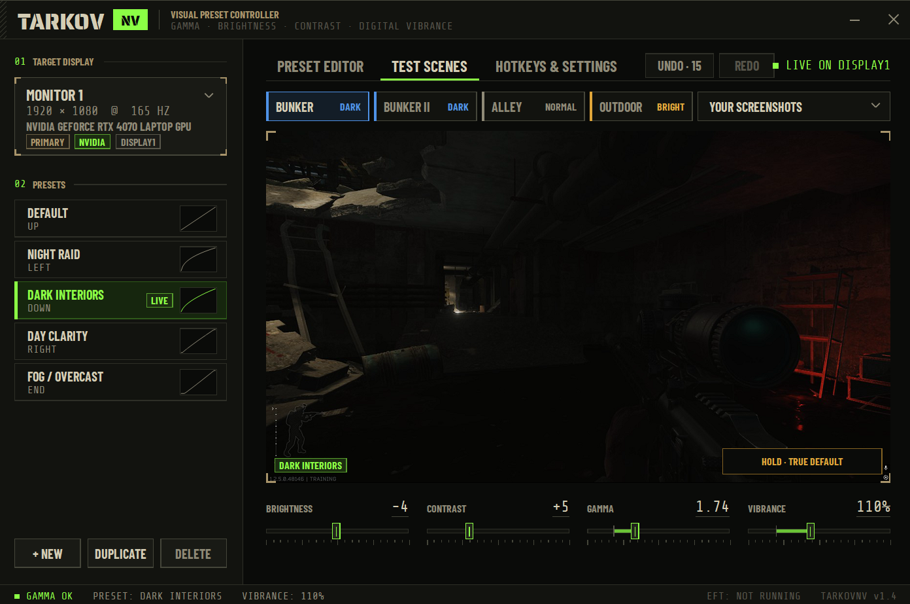

# TarkovNV

<p align="center">
  <b>A high-performance visual enhancement and clarity utility built for Escape from Tarkov.</b>
</p>

<p align="center">
  
  
  
</p>

<p align="center">
  <a href="https://buymeacoffee.com/g.hostproxy">
    
  </a>
</p>

---

<p align="center">
  
</p>

---

## 📌 Overview

**TarkovNV** is a lightweight visual enhancement tool designed to improve clarity, lift shadows in dark indoor areas, and cut through map haze in *Escape from Tarkov*. It adjusts your display's colour output directly (the same way RivaTuner or NVIDIA Control Panel do), so it costs no framerate and adds no input lag. Use it for custom colour grading and contrast adjustments that make targets easier to spot across different maps and lighting conditions.

---

## ✨ Key Features

* **Shadow & Dark Area Boosting:** Lifts pitch-black indoor areas (like Interchange corridors and resort interiors) without washing out outdoor highlights.
* **Highlight Control:** Tames glare from sun, snow, flashlights and bright windows.
* **Haze & Fog Reduction:** Adjusts contrast curves to cut through heavy fog and weather on maps like Woods and Shoreline.
* **Per-Channel RGB Tuning:** Brightness, contrast and gamma for red, green and blue separately, plus temperature and tint.
* **Digital Vibrance up to 250%:** NVIDIA's own vibrance (0–100%) plus an extra saturation boost that works on any GPU.
* **Profile Management:** Save and quickly switch between visual presets using customizable global hotkeys, with separate presets for each monitor.
* **Templates & Test Scenes:** One-click starting points (Night Raid, Pitch Black, NVG Green and more) and built-in test scenes and calibration to preview a preset before you raid.
* **Zero Performance Impact:** Adjustments are applied by your display hardware, so there's no FPS loss and no input lag.

---

## 🚀 Installation & Quick Start

1. Head over to the [Releases](../../releases) page and download the latest `TarkovNV.exe`.
2. Put it in your preferred folder. No installer needed.
3. Run the executable.
4. Configure your preferred visual profiles and hotkeys.
5. Launch *Escape from Tarkov* (borderless windowed recommended) and deploy.

> **Tip:** For strong night presets, click **Unlock (admin)** in the app once and restart your PC. Turn **HDR off** in Windows for best results.

---

## 🛡️ Windows Defender / SmartScreen

TarkovNV is free and unsigned, so Windows may warn you the first time:

* **"Windows protected your PC":** click *More info → Run anyway*.
* **"Virus or potentially unwanted software":** this is a known false positive for small unsigned apps, and the full source code is in this repo. Restore the file from *Windows Security → Protection history*, and feel free to report it to Microsoft at https://www.microsoft.com/wdsi/filesubmission.

TarkovNV never touches or reads the game process. It only changes your display's colour settings through standard Windows and NVIDIA functions.

---

## ⚙️ Configuration

Preferences and custom colour profiles are managed in the app and saved automatically to `%APPDATA%\TarkovNV\config.json`:

* **Hotkeys:** Bind quick-toggle keys for profile switching mid-raid.
* **Curve Adjustments:** Fine-tune gamma, brightness, contrast, shadows, highlights and vibrance.

---

## 🛠️ Building from Source

Requires [Go](https://go.dev/dl/) 1.21 or newer. No other dependencies.

1. Clone the repository:
   ```bash
   git clone https://github.com/g-hostproxy/TarkovNV.git
   cd TarkovNV
   ```
2. Build the executable:
   ```bash
   go build -ldflags "-H windowsgui" -o TarkovNV.exe .
   ```
   Building from Linux/macOS: prefix the command with `GOOS=windows GOARCH=amd64`.

---

## ☕ Support

TarkovNV is free. If it helps you in raids, you can support development here:

<p align="center">
  <a href="https://buymeacoffee.com/g.hostproxy">
    
  </a>
</p>

---

<sub>Unofficial fan-made tool, not affiliated with Battlestate Games. Fonts: Barlow Condensed, Saira Stencil One, Share Tech Mono (SIL Open Font License).</sub>
